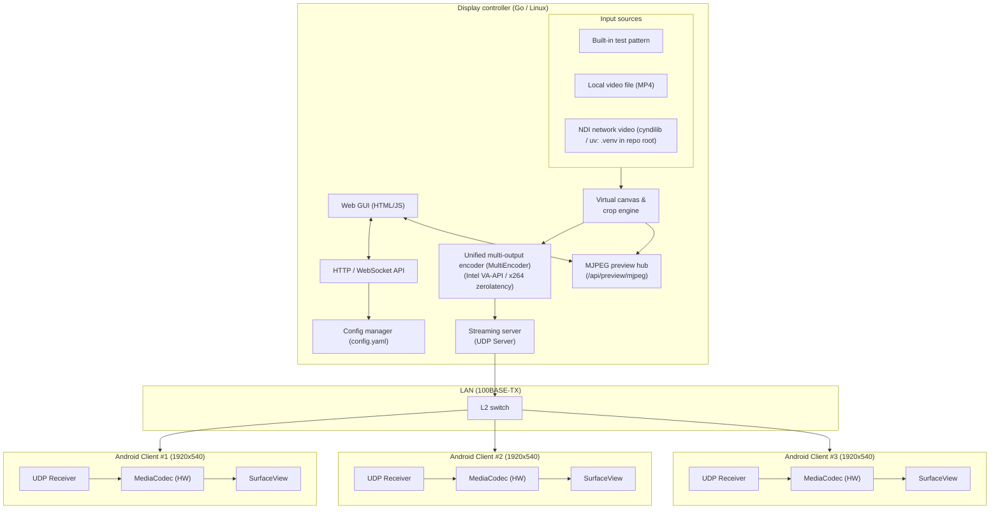

# Architecture Design

This document describes the overall architecture of booth-display, the tiled booth display system, and how the controller is implemented.

---

## 1. System architecture

The system consists of the following main components.

---

## 2. Display controller internals (`controller/`)

### (1) Pipeline
- Input sources:
  - Built-in test pattern (generated natively in Go)
  - Local video file (MP4 / H.264)
  - NDI network video (rawvideo received over a pipe from Python cyndilib, run with uv)
- Virtual canvas mixer (`CanvasMixer`):
  - Composites frames at a fixed 30 fps and handles transitions (cut, crossfade, fade to black).
  - A buffer pool (`sync.Pool`) with reference counting avoids a memory copy per subscriber (zero-copy fan-out).
- Single-process unified encoding (`MultiEncoder`):
  - One FFmpeg process receives a single rawvideo input of the whole canvas (5760x540).
  - `split` and `crop` filters cut it into one region per display.
  - **Hardware acceleration (Intel VA-API)**: when `/dev/dri/renderD128` is available, frames go through `format=nv12,hwupload` to `h264_vaapi` (Constrained Baseline, AUD enabled, no B-frames) for low-latency encoding at very low CPU load.
  - **Software fallback**: if VA-API is missing or fails to initialize, it automatically falls back to `libx264` (ultrafast, zerolatency).
  - Each display's output is passed through an extra pipe descriptor (`pipe:3`, `pipe:4`, ...) to its own goroutine.
- Packetization and UDP output:
  - Parses Annex-B H.264 NAL units and splits each Access Unit (frame) into UDP packets with a 16-byte custom header.
  - Sends them asynchronously over UDP to each display's IP and port.

### (2) Web GUI and API
- Web GUI (`controller/frontend/`):
  - Built with Vue 3 (Composition API / `<script setup>`), Vite and Tailwind CSS.
  - Follows the TechnoTUT design system, with dark and light themes.
  - The Vite build output (`controller/web/dist`) is embedded in the single binary through Go's `embed.FS`.
  - Monitors display connection status (real-time FPS, bitrate and drop rate over WebSocket).
  - Shows the virtual canvas topology, a live MJPEG preview, and crop-region overlays.
  - Lets you edit and save each display's IP, port, resolution, crop position and bezel width from the settings table.
- WebSocket control channel:
  - Two-way communication with clients and the Web GUI, with telemetry sent every second.

### (3) NDI bridge
- `controller/scripts/ndi_bridge.py`:
  - Uses Python's `cyndilib` to discover NDI sources and receive frames.
  - The controller runs it with `uv run --project .` against the uv project in the repository root (`pyproject.toml` / `.venv`, created by `make setup-python`), so the controller must be started from the repository root. The script feeds a rawvideo stream, scaled to the canvas resolution, into the Go pipeline over a UNIX pipe.

---

## 3. Android client internals (`android-client/`)

- Target: Android 7.1 (API 25), ARM Cortex-A17 quad-core, 1 GB RAM
- Responsibilities:
  - Receive UDP packets and reassemble fragments
  - Hardware H.264 decoding with MediaCodec (using the Cortex-A17 VPU)
  - Full-screen rendering to a SurfaceView (immersive mode)
