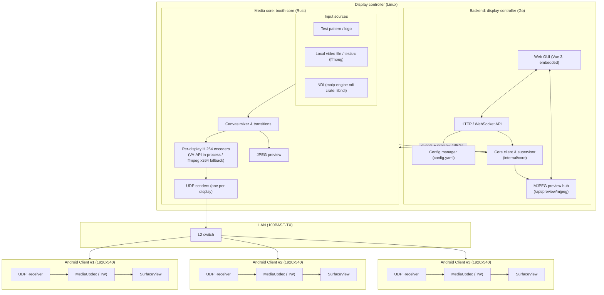

# Architecture Design

This document describes the overall architecture of booth-display, the tiled booth display system, and how the controller is implemented.

---

## 1. System architecture

The display controller is two processes: the Go backend (`display-controller`) serves the Web GUI and API and runs the Rust media core (`booth-core`) as a child process. The media core does all video work.

---

## 2. Display controller internals

### (1) Backend (`controller/`, Go)
- HTTP / WebSocket API and the Web GUI (`controller/frontend/`: Vue 3 Composition API, Vite, Tailwind CSS, TechnoTUT design system with dark and light themes). The Vite build output (`controller/web/dist`) is embedded through Go's `embed.FS`.
- `config.yaml` loading and saving (`internal/config`).
- `internal/core` runs `booth-core engine` and talks to it:
  - **stdin → core**: one JSON command per line with an `id`: `configure` (canvas, displays, encoder), `start`, `stop`, `switch` (source, transition, duration), `discover` (NDI sources), `quit`. Closing stdin also makes the core stop and exit.
  - **core → stdout**: framed messages `[kind u8][flags u8][len u32 LE][payload]` (the framing of moip-engine's preview output): kind 0 is a JSON event (`ready`, `status`, `reply`), kind 2 a preview JPEG.
  - Every command gets a `reply` event; the core sends a `status` event (pipeline, scene, per-display metrics) just before each reply and every 500 ms. The API and the WebSocket telemetry (once a second) serve the latest status.
  - If the core exits unexpectedly, it is restarted after a second and given the last configuration and playback state again.
- The controller needs no cgo and does not touch NDI or video itself.

### (2) Media core (`core/`, Rust)
- Built on [moip-engine](https://github.com/TechnoTUT/moip-engine), included as a git submodule (`moip-engine/`). booth-core uses its `ndi` crate (runtime-loaded libndi bindings, `find_source`, `Receiver::capture_newest_video`); generic NDI functionality belongs there rather than in booth-core.
- Input sources:
  - Built-in test pattern and logo crawl (generated in Rust)
  - Local video file and ffmpeg `testsrc`, read from an ffmpeg child as raw BGRX
  - NDI network video (received in-process, scaled onto the canvas)
- Canvas mixer (`mixer.rs`):
  - Renders at the canvas rate (30 fps), driven by NDI frame arrival when NDI is active, and handles transitions (cut, crossfade, dip to black) without restarting the encoder. Blends run in 16-bit lanes so they vectorize with SSE2.
  - Frames come from a pool and are shared by reference count between subscribers (no per-subscriber copy); a subscriber that falls two frames behind loses frames instead of delaying the others.
- Encoding (`encoder.rs`) picks the encoder from `pipeline.encoder` (`auto`/`vaapi`, `vaapi-ffmpeg`, `software`) and falls back to libx264 when VA-API cannot start. The status reports which one runs (`pipeline.encoder`).
- **In-process VA-API** (`vaenc.rs`, `vaapi/`), the default when `/dev/dri/renderD128` exists:
  - libva (`libva.so.2`, `libva-drm.so.2`) is loaded at run time with hand-written bindings, so the build needs no libva headers; the struct layouts are tested against the libva 2.22 headers (and the installed ones when `libva-devel` is present).
  - One thread and one VA display per display: it takes each canvas frame from the mixer, converts its crop to NV12 (BT.601 limited, `nv12.rs`) straight into the VA input surface and encodes it synchronously. There is no ffmpeg process and no pipe copy of the 12 MB canvas, and the displays encode in parallel.
  - Constrained Baseline, one slice per frame, IDR at the start of every one-second GOP, P-frames with one reference, CBR 12 Mbps with a 1 Mbit HRD buffer, AUD on every access unit. The driver writes slice headers; SPS and PPS are written by booth-core (`vaapi/headers.rs`) and put in front of every IDR, because the drivers emit none without packed headers. The SPS signals no frame reordering, so decoders output each frame at once.
  - Works with both Intel drivers: iHD (Broadwell and newer) and i965 (Ivy Bridge / Haswell, the i5-3470 target). Measured on an i5-6500, 3 x 1920x540 at 30 fps, frame in to access unit out: iHD 10.2 ms median at 36% of one core, i965 8.9 ms at 30%; the ffmpeg h264_vaapi path took 18-20 ms at about 66%.
- **ffmpeg encoding** (libx264 fallback, and `vaapi-ffmpeg`): one process for all displays:
  - One ffmpeg process receives the whole canvas (5760x540 BGRX) once; `format`, `split` and `crop` filters cut it into one region per display.
  - **VA-API**: when `/dev/dri/renderD128` is available, the canvas is converted to `nv12` once, split, and each crop goes through `hwupload` to `h264_vaapi` (Constrained Baseline, AUD, no B-frames, every GOP starts with an IDR).
  - **Software fallback**: if VA-API is missing or ffmpeg exits within the 2 s startup probe, `libx264` (ultrafast, zerolatency, one thread per display) is used.
  - Each display's output is muxed as FLV and passed through an extra pipe (`pipe:3`, `pipe:4`, ...). FLV carries the size of every frame, so an access unit is forwarded as soon as it is complete (`flv.rs`).
- Packetization and UDP output (`sender.rs`, `protocol.rs`): each access unit is converted to Annex-B, split into packets with the 16-byte header, and queued for a send thread. A frame is queued whole or dropped whole, and after a drop P-frames are skipped until the next keyframe.
- Preview (`preview.rs`): every canvas frame is thinned to 15 fps, downscaled to 1280 px wide and JPEG-encoded in-process.

### (3) NDI input (`core/src/ndi_input.rs`)
- One finder lives for the whole process, so it already knows the senders when a source is looked up. Only right after it is created does discovery wait for the list to settle.
- The receiver asks for video only (UYVY, full bandwidth, progressive); audio and metadata are not requested, so the SDK discards them. Sources with alpha arrive as BGRA.
- Capture waits inside the SDK for the next frame and returns the moment it arrives; frames that queued up meanwhile are released at once and only the newest is used.
- Receivers are reused: switching sources reconnects a pooled receiver. A receiver whose session died is never torn down on the receive thread (that blocks inside the SDK for 10 s or more); it is destroyed in the background, followed by `malloc_trim`.
- Each frame is converted (only the cropped UYVY rows), center-cropped and bilinearly scaled onto the canvas on all cores (`scale.rs`, no SIMD dependency) and the mixer is signalled. A source faster than the canvas rate is thinned to about the canvas rate.
- It recovers by itself: a missing source is looked for until it appears, a source silent for 2 s (doubling up to 30 s) while NDI still reports a connection gets a fresh receiver, and a sender that comes back after dropping off the source list (or under another address) is connected to at once. The last frame stays on the canvas meanwhile.

---

## 3. Android client internals (`android-client/`)

- Target: Android 7.1 (API 25), ARM Cortex-A17 quad-core, 1 GB RAM
- Responsibilities:
  - Receive UDP packets and reassemble fragments
  - Hardware H.264 decoding with MediaCodec (using the Cortex-A17 VPU)
  - Full-screen rendering to a SurfaceView (immersive mode)
